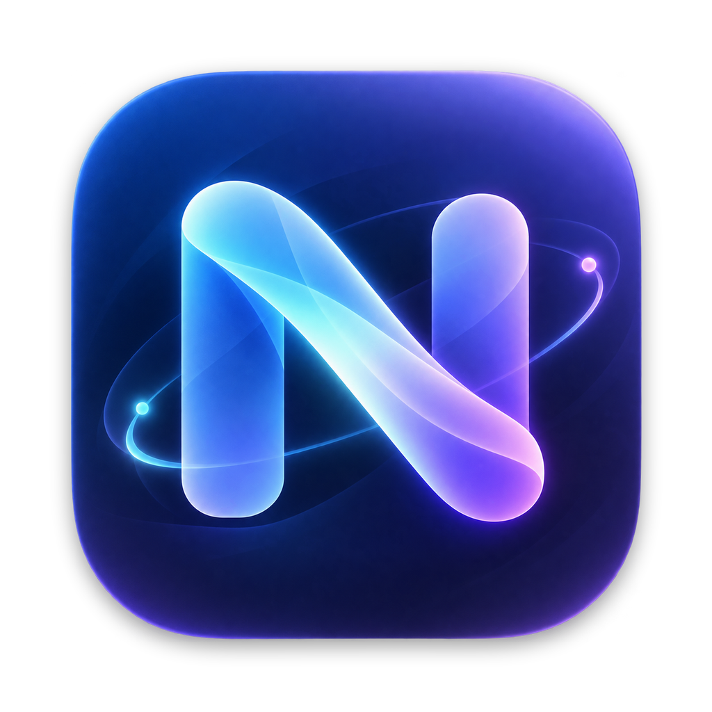

<p align="center">
  
</p>

# Nowbeam

隐私优先的原生 macOS 状态上报软件：只把你明确允许分享的当前活动，通过通用的 WebSocket 协议直接发送给一个或多个接收端，不绑定任何网站或博客系统。

> **状态：开发中，尚未正式发布。** 原生客户端与可选接收服务均已实现并有本机运行证据，但签名、公证以及多项真实环境验收尚未完成，详见[项目状态](#项目状态)。

## 目录

- [特性](#特性)
- [项目状态](#项目状态)
- [系统要求](#系统要求)
- [快速开始](#快速开始)
- [使用指南](#使用指南)
- [项目结构](#项目结构)
- [开发与测试](#开发与测试)
- [发布](#发布)
- [隐私与安全](#隐私与安全)
- [第三方组件](#第三方组件)
- [文档索引](#文档索引)
- [许可证](#许可证)

## 特性

**客户端（macOS 原生菜单栏软件）**

- 三个相互独立的来源：前台应用、窗口标题、媒体。每个来源单独开关，关闭即停止读取，而不是读取后在网络层丢弃。
- 窗口标题默认关闭；开启后仍须命中按应用管理的白名单，并由用户授予辅助功能权限。
- 媒体来源支持 QQ 音乐与网易云音乐，只读取系统当前选中的有效会话，不读取账号、历史、缓存或音频。没有音乐是正常状态。
- 发出前展示准确的脱敏预览，预览与实际发送使用同一份过滤结果。
- 同时向多个接收端上报；每个接收端独立配置地址、凭证、启停、连接状态与错误，一个失败不会阻塞另一个。
- “已发送”与“接收方已确认”分开呈现：只有收到接收端的 ACK 才显示“已确认”。
- 菜单栏面板可直接暂停/恢复分享；界面采用 macOS 26 起的 Liquid Glass 设计语言，旧系统退回系统材质。

**协议与接收服务**

- 上报协议为 **WSS + JSON**（子协议 `nowbeam.v1`），任何后端都可以按[协议规范](protocol/README.md)实现，不必使用 Nowbeam 的服务。
- 可选的独立接收服务是协议的自托管参考实现，**不是必经中转**：单所有者、多设备，按设备返回当前状态，公开读取需所有者显式开启，不保存活动历史。

**不在范围内**：嵌入卡片、公开展示页、网站专用适配、音乐账号登录、活动历史、Web 管理后台。

## 项目状态

| 范围 | 状态 |
| --- | --- |
| macOS 客户端 | 已实现，在 macOS 27 / Apple Silicon 本机开发运行 |
| 独立接收服务 | 已实现，含容器化部署配置 |
| 协议 v1 | Schema 与示例通过静态校验，接收服务实现了其连接、顺序与租约规则 |
| 正式发布 | **未完成**：Developer ID 签名与公证尚未进行，当前产物为 ad-hoc 开发签名 |

“实现存在”“自动测试通过”“受限环境实测”“正式发布”是四件不同的事。Schema 校验、合成样本和第三方项目的测试结果都不能当作真实采集验证。

**已验证（macOS 27 / Apple Silicon 本机）**

- Go 竞态测试、`go vet` 与二进制构建；Swift 测试 Debug 22 个 Core + 12 个 Capture，Release 16 个 Core + 12 个 Capture（回环连接生命周期测试仅在 Debug 运行）。
- 接收链路：一次性初始化、管理与设备权限隔离、公开开关、精确 Origin、连接接管、乱序/冲突、凭证撤销、45 秒租约（实测约 45.035 秒过期，重复快照不续租）；原生 WSS 拒绝不可信证书，未修改系统信任。
- 解锁桌面下前台应用与 QQ 音乐的真实采集（曲目、播放状态与位置经接收端确认并随播放推进）；锁屏立即清空来源并以空快照保活，解锁后恢复。
- 两个本机接收端同时 ACK、停用其一不影响另一个；独立的 Keychain 保存/读取/删除。
- `make app` 生成 ARM64、ad-hoc 签名的 `.app` / DMG 并实际启动；Linux/ARM64 的 scratch 接收器镜像以非 root、只读根文件系统运行，重启后所有者与设备身份保留、旧活动不恢复。

**尚未验收**

- 界面改版（SwiftUI 场景入口、菜单栏面板、Liquid Glass 外壳）之后的菜单栏面板真实点击、面板内暂停/恢复、退出清理、⌘V 粘贴凭证，以及 macOS 15 的材质回退外观。此前观察到的菜单暂停与正常退出发生在改版前的入口上。
- 辅助功能授权及撤销下的窗口标题采集；QQ 音乐播放器退出清除的逐项记录；网易云音乐完整生命周期（本机未安装）。
- 睡眠/唤醒转换、端到端延迟 p95、macOS 15 实机、受系统信任的正式 WSS 联合部署。
- 正式签名包的媒体运行、Developer ID 签名与公证。CI 已配置，但尚未触发远端运行。

完整验收标准与证据见[产品规格](docs/product.md#7-首版验收标准)。

## 系统要求

| 项目 | 要求 |
| --- | --- |
| 运行 | macOS 15 或更高，Apple Silicon；Liquid Glass 外观需要 macOS 26 或更高 |
| 构建客户端 | Apple Silicon Mac；能编译本包的 Swift 6 工具链（CI 注释记录 Xcode 16.x 编译本包会崩溃，实际使用 Xcode 26 及以上） |
| 开发工具 | Python 3.11+、`make`；Python 与项目内 CMake 只用于校验和构建媒体资源，终端用户不需要 |
| 构建接收服务 | Go 1.26 或后续受支持版本 |

首次构建需要联网下载固定版本的媒体依赖。媒体运行使用系统 `/usr/bin/perl`；终端用户无需安装 Homebrew、Python、CMake 或 Swift 编译器。最低系统版本是开发兼容目标，不是测试结果：macOS 15 尚无实机验收。

## 快速开始

### 构建并运行客户端

在仓库根目录执行：

```sh
make setup        # 在项目内 .venv/ 安装开发依赖，不改全局配置
make app-debug    # 构建 Debug 版 dist/Nowbeam.app，ad-hoc 签名
open dist/Nowbeam.app
```

`make app` 构建 Release 版 `dist/Nowbeam.app` 与 `dist/Nowbeam.dmg`，同样是 ad-hoc 签名、未公证，**不等于正式发布**。两种构建共用并替换 `dist/Nowbeam.app`。

底层入口是 [scripts/build_macos.py](scripts/build_macos.py)，可通过 `APP_ARGS` 传入 `--bundle-id`、`--sign-identity`、`--skip-dmg` 等参数。只有维护者授权的标识与签名身份才可用于正式签名，脚本不执行公证或发布。不要通过关闭 Gatekeeper、SIP 或系统证书校验来运行软件。

### 运行可选的接收服务

```sh
make build-receiver    # 输出 services/receiver/bin/nowbeam-receiver
```

首次部署需要先在仓库以外的私人目录生成初始化凭证。启动、TLS、反向代理、容器部署与 HTTP API 见[接收服务指南](services/receiver/README.md)。

## 使用指南

1. **启动与暂停。** 点击菜单栏图标打开面板：可直接暂停/恢复分享，并看到准确预览和各接收端状态；“设置…”打开设置窗口。**每次启动整体分享都会暂停**，已保存的来源和接收端配置不等于授权自动恢复分享。
2. **选择来源（“来源与隐私”）。** 按需开启应用、窗口或媒体。窗口默认关闭，须另行添加应用白名单并授予辅助功能权限；被隐藏的应用同时禁止读取其窗口标题。媒体与应用来源相互独立。
3. **添加接收端（“接收端”）。** 填写完整的 `wss://` 地址与该接收方签发的设备凭证。各接收端的身份、Keychain 凭证、连接和错误互相独立；新增或替换接收端默认不启用。“检查连接”只验证 welcome，不发送活动。
4. **检查并恢复（“分享与预览”）。** 核对准确预览，启用需要的接收端后明确点击“恢复分享”。暂停后已启用的接收端仍可收到空快照，以区分“在线但没有活动”和“离线”。
5. **自托管服务（“接收服务管理”，可选）。** 按[接收服务指南](services/receiver/README.md)部署，再在设置里连接实例、初始化或输入已有的所有者凭证、签发设备凭证并添加到本机接收端。所有者管理凭证与设备上报凭证不可互换；公开读取默认关闭，必须另行显式开启。

如果界面显示“系统保护中”，请查看其中的会话诊断。软件不会通过绕过保护来获得活动。锁屏判定使用 `CGSessionCopyCurrentDictionary` 中未文档化的 `CGSSessionScreenIsLocked` 字段：macOS 27 实测该键仅在锁屏期间出现，键存在即视为锁屏；字典整体不可得或公开会话键异常时 **fail-closed**，停止全部采集，预览与发送均为空。该语义依赖系统行为，系统升级后需要重新实测。

**Debug 构建的本机开发开关。** Debug 构建在“来源与隐私”中提供明确的本机明文开关，只允许 `127.0.0.1` / `::1` 的 HTTP 管理与 WS 上报，例如 `http://127.0.0.1:8787` 与 `ws://127.0.0.1:8787/api/v1/ingest`。Release 不提供这个例外，必须使用系统信任的 HTTPS/WSS；Debug 本机成功不能代替正式 TLS 验收。

## 项目结构

```text
apps/macos/            原生客户端（SwiftPM）
  Sources/NowbeamCore/     协议模型、隐私投影、凭证、连接状态机
  Sources/NowbeamCapture/  前台应用、窗口标题、媒体与会话保护采集
  Sources/NowbeamApp/      SwiftUI 界面与组合根
  MediaSupport/            媒体 gate 与受管宿主脚本
services/receiver/     可选的独立接收服务（Go module，SQLite）
protocol/              线协议规范、JSON Schema 与虚构示例
docs/                  产品规格与架构决策
scripts/               仓库校验与 macOS 打包脚本
.github/               CI 工作流
```

依赖方向：`NowbeamCore` 不依赖界面，`NowbeamCapture` 依赖 `NowbeamCore`，`NowbeamApp` 组装两者。JSON 契约是跨语言的公共边界，两端各自实现，不共享系统原始对象。

## 开发与测试

在仓库根目录执行，检查、测试与打包相互独立：

```sh
make check                                    # 协议 Schema、正反例、文档链接、指令层级、文本格式
make test-receiver                            # Go 竞态测试与 vet
make test-macos                               # Swift 测试（Debug）
make test-macos SWIFT_CONFIGURATION=release   # Swift 测试（Release）
make build-receiver                           # 构建接收服务二进制
make test                                     # 聚合两端行为测试
```

`make check` 只校验契约、文本和仓库结构，不启动产品，也不证明端到端行为。CI 配置在 [.github/workflows/check.yml](.github/workflows/check.yml)，配置存在不等于已触发或通过远端运行，也不会自动部署或发布。

真实验收必须覆盖：前台切换、同应用窗口变化、两款播放器、权限撤销、锁屏/解锁、过期、重连和两个独立接收端。没有对应环境的项目要明确标注“未验证”，不得用另一个播放器或模拟数据代替。

参与开发前请先阅读 [AGENTS.md](AGENTS.md)（协作约定与不可重新解释的产品边界）、[CONTEXT.md](CONTEXT.md)（领域术语）和各子目录的 `AGENTS.md`。

## 发布

发布由 [release.yml](.github/workflows/release.yml) 自动完成，版本号只来自仓库根目录的 [`VERSION`](VERSION)：

1. 要发新版本，在 PR 中把 `VERSION` 改成新的 `主.次.修订`（只能提高；`make check` 会校验格式）。
2. PR 合并到 `main` 后，流水线发现 `v<VERSION>` 标签还不存在，就自动构建、发布并创建该标签；`VERSION` 没变的合并不会发布。
3. 涉及发布的 PR（改动 `release.yml`、`VERSION`、打包脚本或接收服务 Dockerfile）会在合并前演练一次完整构建，但不发布。

流水线会先复核检查与测试，再构建并发布以下内容，GitHub Release 一律标记为**预发布**：

| 产物 | 说明 |
| --- | --- |
| `Nowbeam-<版本>-macos-arm64-adhoc.dmg` | 客户端，ad-hoc 签名、未公证 |
| `nowbeam-receiver-<版本>-linux-{amd64,arm64}.tar.gz` | 接收服务二进制，附第三方许可文本 |
| `ghcr.io/<所有者>/nowbeam-receiver:<版本>` | 接收服务多平台镜像（首次推送默认私有，需维护者在包设置中公开） |
| `SHA256SUMS` | 以上文件的校验和 |

在 GitHub 的 Actions 页面手动运行 “Release” 同样只演练。客户端的 `CFBundleShortVersionString` 与 `VERSION` 一致。发布失败时标签不会创建，修复后下一次推送到 `main` 会自动重试；若镜像已推送，会被同版本号覆盖。Developer ID 签名与公证需要维护者提供身份和凭据，尚未接入。

## 隐私与安全

- 软件只上传你明确允许的当前快照，不记录活动历史；本地过滤发生在进入网络、诊断日志和发送队列之前。
- 日志不记录标题、曲名、消息正文、令牌或认证头；凭证只存 Keychain，不进入 URL、仓库、普通设置文件或日志，每个接收端的凭证与设备身份相互独立。
- 锁屏清除全部活动；睡眠与退出尽力撤回，异常断线依靠接收端 45 秒租约兜底；断网不保存活动队列，恢复后重新采集当前状态。
- 公开状态可被任何访问者读取并另行保存。发送前的本地过滤不能代替对接收方的信任，也无法撤销别人已经保存的内容。

## 第三方组件

媒体采集固定使用 [ungive/mediaremote-adapter](https://github.com/ungive/mediaremote-adapter/tree/0e82bf1c44ec39554fbfc402ec88a48c6ae2a0fd)（BSD-3-Clause）的审查版本，构建时校验归档 SHA-256，原许可与来源记录随包保留。完整锁定值见[架构说明](docs/architecture.md#6-媒体依赖决策与实测门槛)。

自有的 gate 与 Perl 宿主只在受管子进程内读取媒体状态，不远控播放器，不读取账号、Cookie 或缓存。MediaRemote 是私有接口，系统更新后仍需重新验证。接收服务依赖 [coder/websocket](https://github.com/coder/websocket) 与 SQLite 驱动，版本见 [go.mod](services/receiver/go.mod)。

## 文档索引

| 文件 | 内容 |
| --- | --- |
| [AGENTS.md](AGENTS.md) | 协作约定、不可误解的产品边界与验证要求 |
| [CONTEXT.md](CONTEXT.md) | 领域术语：来源、在线、公开状态、接收端的区别 |
| [docs/product.md](docs/product.md) | 首版完整范围、隐私与生命周期规则、验收标准与当前证据 |
| [docs/architecture.md](docs/architecture.md) | 技术裁定、目录组织、独立接收服务与采集约束 |
| [protocol/README.md](protocol/README.md) | WSS 握手、消息、租约、连接替换及消费者规则 |
| [protocol/v1/message.schema.json](protocol/v1/message.schema.json) | JSON Schema 2020-12 消息结构契约 |
| [protocol/v1/examples.json](protocol/v1/examples.json) | 可校验的虚构协议消息示例 |
| [services/receiver/README.md](services/receiver/README.md) | 接收服务的构建、启动、TLS、原生管理与 HTTP API |

## 许可证

本项目的许可证**尚未确定**，在维护者明确指定之前，请不要假定任何开源许可。第三方组件各自的许可见[第三方组件](#第三方组件)。
