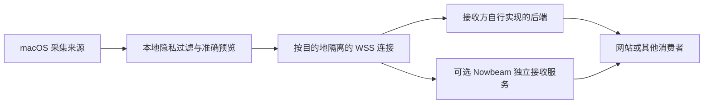

# 架构与技术裁定

本文件记录用户已确认方向及其授权裁定的工程选择。当前原生 macOS 客户端、媒体辅助进程与可选 Go 接收服务已有实现；本机开发运行证据与未验收项见[产品规格](product.md#当前证据与未验收项)。不能把依赖能力、自动测试或开发签名包等同于播放器兼容和正式发布。

## 1. 部署与职责

- 客户端没有中央账号或必须经过的中转。目的地只需实现 [通用协议](../protocol/README.md)。
- 所有日常客户端操作在原生软件内。Nowbeam 接收服务的所有者管理是软件内一个能力，不是新增 Web 后台，也不是所有第三方接收端必须实现的协议。
- 不把接收服务内置到 macOS 软件进程；用户的 Mac 无须开放公网端口。独立接收服务可以部署在任意符合运行条件的主机上。
- 首版不提供自动配置云服务器、内网穿透、自动端口映射或托管云平台。

## 2. 技术栈

| 部分 | 裁定 | 理由与边界 |
| --- | --- | --- |
| macOS 软件 | Swift 6 语言模式，SwiftUI + AppKit | 原生菜单栏、权限和系统事件；不引入 Electron、Tauri 或 Web UI |
| 网络 | Foundation `URLSessionWebSocketTask` | 支持自定义请求头、子协议、消息大小限制及控制 Ping；不另加客户端网络库 |
| 凭证 | macOS Keychain | 与普通配置隔离，开发与正式应用使用独立命名空间 |
| 前台应用 | `NSWorkspace` 当前应用与激活通知 | 启动和恢复时重新读取，事件后生成新快照 |
| 窗口标题 | Accessibility / `AXObserver` | 同时观察焦点窗口和标题变化；不能仅监听前台应用切换 |
| 媒体 | 隔离的 MediaRemote 适配模块 | 允许私有 API；不直接耦合到 UI、协议或接收服务 |
| 会话保护 | `CGSessionCopyCurrentDictionary` + 发送前复核 | API 公开，但 `CGSSessionScreenIsLocked` 字段未文档化；缺失、锁定或无法确认安全会话时停止全部采集 |
| 独立接收服务 | Go 1.26 或后续受支持版本，标准库 HTTP + `coder/websocket` | 支持上下文取消、读大小限制和标准 WebSocket；保持单服务进程 |
| 持久化 | SQLite | 只保存实例配置、设备记录和凭证校验数据；不保存活动轨迹或最后活动快照 |
| 瞬态状态 | 内存中的按设备状态机 | 原子处理连接归属、序号、过期与公开投影；重启后重新建立状态 |
| 部署 | Linux 容器 + 单个持久化目录 | 一个实例一个进程，不要求 Redis、PostgreSQL 或消息代理 |
| 开发构建与契约检查 | Python、JSON Schema 2020-12、项目内 CMake | 检查跨语言契约并构建媒体资源；Python/CMake 不进入客户端或服务端产品运行依赖 |

当前已有 macOS 27 / Apple Silicon、Swift 6.4、Go 1.26.5、Xcode 27.1 环境下的 Debug 应用和 Go 服务构建记录。它不证明 macOS 15 最低系统已验收，也不是这些工具版本为最新安全补丁的声明。实际依赖及媒体源码已锁定，不从未固定的上游分支直接打包。

## 3. 模块接口与并发

### 客户端

- 采集模块只输出本机原始观测及可用性；任何外部输出之前必须经过隐私模块。
- 隐私模块输出不可变完整快照。UI 预览和发送使用同一份投影，不能各自重新拼装而产生差异。
- MainActor 仅承载 UI 和要求主线程的系统接口；媒体辅助进程与网络不能阻塞主线程。
- 每个目的地拥有独立连接状态机：启停、连接代次、序号、待确认消息、最新待发快照和错误。不得创建无界队列。
- 每个目的地最多一条待确认快照及一份最新待发快照；隐私收紧时立即丢弃旧待发内容，必要时断开旧连接撤销其写入权。
- 采集失败表示该来源不可用，不保留无限期有效的旧值。保活前确认来源仍有效，不能用一个健康网络任务替已经卡死的采集器续命。
- 每个目的地收到接收端签发的独立设备 ID；不传硬件指纹、原始 bundle ID、PID、路径或系统用户名。
- 会话通知只触发重新检查；锁定、睡眠或不能确认安全会话时停止所有采集，预览与发送均为空。每次发送前重新读取保护状态，未文档化锁屏字段缺失时 fail-closed，绝不按“默认解锁”处理。
- 客户端采集期限 5 秒，开始发送后另计 ACK 期限 5 秒；welcome 后首快照期限 10 秒，正常保活间隔 15 秒。慢采集不能耗掉 ACK 预算，超时仍必须终止失效连接；状态回调也按代次隔离，不能让旧 confirmed 覆盖停止状态。
- 采集及保护计时器使用 common run-loop mode，避免菜单或窗口交互阻塞必要的刷新。每次应用启动强制暂停整体分享；来源配置、目的地启用和整体分享授权分别管理。

### 接收服务

- 使用小而完整的设备状态模块统一处理快照提交、连接接管、断开清理、撤销和到期。HTTP / WebSocket handler 不直接改共享 map。
- 每次提交必须在同一临界区验证连接归属、检查顺序、替换完整快照、设置租约，再生成 ACK；不能先 ACK 后保存。
- 新连接第一份有效快照接管设备。旧连接的后续消息与关闭回调均以连接 ID 校验权限，不能清理新快照。
- 到期调度器主动清除；读取接口也必须以接收端时间检查租约，不能依赖定时器一定准时执行。
- 管理数据通过 SQLite 事务持久化；活动只存在内存。单进程假设必须明确，不允许多个副本共享一个 SQLite 文件并假装支持高可用。
- 依赖按真实职责组织；接口用于确实需要替换的系统采集、时钟或存储，不制造空壳 service/repository 层。

## 4. 独立接收服务的管理与公开读取

- 部署时配置一次性高熵初始化凭证，通过受保护的部署配置交给所有者，不能开放“第一个访问者成为管理员”。软件内输入实例地址和初始化凭证，换取独立管理凭证并放入 Keychain。初始化仅成功一次；管理凭证仅返回一次，失去它不会重新开放 bootstrap。各目的地的设备凭证与管理凭证分别存储。
- 软件内完成设备凭证签发/撤销、实例公开读取开关和公开设备名称设置。管理接口使用单独权限，不要求普通设备持有管理令牌。
- 第三方接收端自行提供其凭证；客户端不能假设第三方支持 Nowbeam 的初始化或管理接口。
- 公开读取路径为 `GET /api/v1/presence`，默认拒绝匿名读取；所有者开启后只返回允许公开的当前设备状态。
- 返回设备级 `online`、来源快照、接收时间和失效时间；媒体位置使用接收端归一化锚点。任何内部连接 ID、认证信息和本机标识都不进入公开响应。
- 无活动不是 404：设备可在线且来源全空。离线设备的来源必须全空；撤销设备从公开结果移除。
- 响应使用 `Cache-Control: no-store`。消费者不得在失效时间以后继续展示旧内容；更不能把永久缓存当实时状态。
- CORS 仅控制浏览器跨域访问，不作为身份校验或防止他人读取的措施。展示端的具体界面与实时订阅方式不在本次交付范围。

## 5. 网络与分发安全

- 用户可配置完整 WSS 地址，不固定某个博客路由。身份验证位于握手 `Authorization` 头；不把令牌放查询参数、子协议名或日志。
- 正式客户端仅允许 `wss://` 上报和 `https://` 管理。Debug 构建可由用户显式允许 `127.0.0.1` / `::1` 的 WS/HTTP，不能将这个例外扩大到局域网、`localhost` 或任意主机；Release 没有明文例外。
- 使用系统信任链校验证书；不自动信任自签名证书，不自动跨域重定向或转发凭证。
- 自托管可由可信反向代理终结 TLS。明文上游只允许回环或受保护的私有网络；公网不得裸露 WS 端口。代理必须支持 Upgrade，空闲超时需大于保活窗口。
- 默认不启用 WebSocket 消息压缩。小型元数据不值得增加压缩侧信道和额外资源开销；图片与二进制不属于 v1 消息。
- 单条完整消息上限 64 KiB；分片重组后的总大小同样受限。鉴权、限制和 JSON 解析要在产生状态副作用前完成。
- 正式 `.app` / DMG 需要维护者的 Developer ID 签名与公证。当前没有据此获批的发布身份，不声称已经可公开分发。

## 6. 媒体依赖决策与实测门槛

已接入 [ungive/mediaremote-adapter](https://github.com/ungive/mediaremote-adapter/tree/0e82bf1c44ec39554fbfc402ec88a48c6ae2a0fd)，使用系统 `/usr/bin/perl` 宿主加载辅助框架访问私有 MediaRemote；这是特定实现机制，不是 Apple 公开稳定接口。构建固定以下来源，并拒绝摘要不符的归档：

- 提交：`0e82bf1c44ec39554fbfc402ec88a48c6ae2a0fd`。
- codeload tar.gz SHA-256：`9e31b154dc7be207a42b7bb1ba1b161bfdee541a15d692cba1c37740f13b23e2`。
- 许可：BSD-3-Clause；原始 `LICENSE` 和记录仓库、提交、摘要的 `provenance.json` 随媒体资源放入 `.app/Contents/Resources/MediaRemote/`，不得只留一个上游链接代替许可声明。

应用还包含自有 `NowbeamMediaGate.m` 与 `media-host.pl`，只暴露 snapshot/events 读取，不提供远程播放控制。辅助代码只运行在本软件创建并管理的子进程内，不附加或注入 QQ 音乐/网易云音乐进程。系统当前选中的会话只有属于两款目标播放器、PID 和前后播放状态核验一致时才投影；不能把 `playing=false` 泛化成暂停，停止、退出或无法确认有效时清空。

- 媒体 snapshot 辅助进程限时 4 秒，不允许卡死采集替旧状态续租；失败时报告来源不可用，而不是保留旧曲目。
- 最终签名包中必须重新验证辅助框架加载、子进程退出、缺失系统运行时、媒体结束清除和许可声明；源码或 ad-hoc 包可运行不代表正式签名包可运行。
- Python/CMake 只用于开发构建；终端用户不需要 Homebrew 或 Swift 编译器，但当前媒体实现依赖系统 `/usr/bin/perl`。运行条件缺失时明确报告不可用，不能换成 Cookie、账号或缓存抓取。
- 本机只读 MediaRemote 和自有 gate 探针已成功；当前系统媒体并非 QQ 音乐或网易云音乐，因此不构成目标播放器验收。QQ 音乐 11.10.5 已安装，常见目录未发现网易云音乐；两者各自真实生命周期均仍须验收，不借用上游或其他播放器结果。
- 当前系统锁定保护已实际生效，但真实前台/窗口采集与 AX 权限尚未验收。最低 macOS 15 与 Apple Silicon 是首批目标；私有接口及未文档化锁屏字段随系统更新可能失效，支持矩阵必须跟随实测维护。

## 7. 实现目录与工程入口

- `apps/macos/`：SwiftPM 工程；`Nowbeam` 是原生入口，`NowbeamCore` 管理模型、隐私投影、凭证与连接，`NowbeamCapture` 管理桌面、会话保护和媒体采集；`MediaSupport/` 保存自有媒体 gate 与宿主。
- `services/receiver/`：独立 Go module，`cmd/nowbeam-receiver/` 放入口，`internal/` 按协议、设备状态、HTTP 管理和存储职责拆分；具体构建、部署和 API 见[服务 README](../services/receiver/README.md)。
- `scripts/build_macos.py`：校验并构建固定媒体依赖、生成独立 `.app`，可生成 DMG；开发输出在 `dist/`，默认 ad-hoc，未公证。`make app-debug` 构建 Debug `.app`，`make app` 构建 Release `.app` 和 DMG，完整前提见[根 README](../README.md#构建与启动原生软件)。
- `make check` 是静态契约与仓库检查，`make test-receiver` 和 `make test-macos` 是两端行为测试；`make build-receiver` 生成可运行服务。原生软件日常配置仍在图形界面，不用开发命令替代用户操作。
- 不建立共享语言运行库；以 `protocol/` 为契约来源，各语言模型各自实现。真实接收链路与 Swift 状态机测试不能替代系统采集、两款播放器和正式 TLS/签名包的联合验收。

当前已经贯通双本机接收端与原生管理，但受锁定会话、AX 未授权、缺失目标播放器及最低系统/签名条件限制，仍存在明确未验收项。所有范围按产品规格完整保留，不把阶段性可运行结果当作首版发布完成。

## 8. 依据

- [RFC 6455](https://www.rfc-editor.org/rfc/rfc6455)：握手、子协议、控制帧、消息限制与关闭码；认证可使用 HTTP 请求头。
- [Apple URLSessionWebSocketTask](https://developer.apple.com/documentation/foundation/urlsessionwebsockettask)：原生 WebSocket 能力。
- [Apple maximumMessageSize](https://developer.apple.com/documentation/foundation/urlsessionwebsockettask/maximummessagesize)：完整接收消息的缓冲上限。
- [Apple NSWorkspace 激活通知](https://developer.apple.com/documentation/appkit/nsworkspace/didactivateapplicationnotification)：前台切换事件。
- [Apple Accessibility 授权查询](https://developer.apple.com/documentation/applicationservices/1459186-axisprocesstrustedwithoptions)：授权提示异步，不能把发出提示当已获得权限。
- [Apple AXObserverAddNotification](https://developer.apple.com/documentation/applicationservices/1462089-axobserveraddnotification)：窗口/标题通知注册。
- [coder/websocket](https://github.com/coder/websocket)：ISC 许可、上下文取消、消息大小限制等能力；上游当前模块要求 Go 1.26。
- [MediaRemote Adapter](https://github.com/ungive/mediaremote-adapter)：私有接口机制、系统版本支持声明与 BSD-3-Clause 许可；支持声明不是本项目验收结果。
